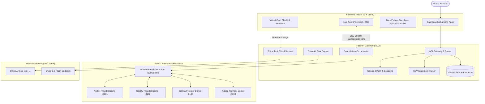

# SubSlayer AI 🗡️💳

> **Autonomous AI-Driven Subscription Assassin & Financial Burner Shield**  
> *Built for the Hackathon by a 5-member engineering & research team.*

[](https://fastapi.tiangolo.com)
[](https://www.python.org)
[](https://react.dev)
[](https://www.typescriptlang.org)
[](https://tailwindcss.com)
[](https://vitejs.dev)
[](https://stripe.com)
[](LICENSE)

---

## 📖 Table of Contents

- [Overview](#-overview)
- [The Problem & Value Proposition](#-the-problem--value-proposition)
- [Key Features](#-key-features)
- [System Architecture](#-system-architecture)
- [Team Roster & Ownership](#-team-roster--ownership)
- [Repository Structure](#-repository-structure)
- [Getting Started](#-getting-started)
  - [Prerequisites](#prerequisites)
  - [Backend Setup (FastAPI Gateway)](#backend-setup-fastapi-gateway)
  - [Frontend Setup (React 19 + Vite)](#frontend-setup-react-19--vite)
  - [Multi-Device Demo Configuration](#multi-device-demo-configuration)
- [API Reference](#-api-reference)
- [Testing & Quality Assurance](#-testing--quality-assurance)
- [License](#-license)

---

## ⚡ Overview

**SubSlayer AI** frees consumers from predatory "vampire" subscriptions and deceptive retention dark patterns. By pairing an **autonomous AI cancellation agent** with a **zero-out financial burner shield**, SubSlayer AI detects zombie subscriptions, bypasses aggressive cancellation mazes, and blocks unauthorized charges before they ever touch your primary bank account.

---

## 🩸 The Problem & Value Proposition

- **The Zombie Subscription Drain:** The average consumer loses over **$219/month** to forgotten subscriptions, sneaky renewal auto-bills, and unmonitored free trials.
- **Retention "Dark Patterns":** Streaming services and enterprise SaaS deliberately trap users in convoluted multi-step cancellation flows, hidden cancel buttons, guilt-trip modals, and aggressive discount bribes—violating the consumer-friendly spirit of the FTC's *Click-to-Cancel* mandate.
- **The SubSlayer Defense:**
  1. **Autonomous Cancellation Agent:** Executes cancellations on the user's behalf with real-time SSE execution telemetry, navigating deceptive cancellation funnels to confirmed termination.
  2. **Financial Burner Shield:** Generates instant disposable virtual cards with a **$0.00 Balance Lock Shield** that auto-bounces sneaky charges with zero impact on personal funds.
  3. **Vampire Risk Engine:** AI intelligence powered by Qwen analyzes subscription velocity, hidden price hikes, and cancellation friction.
  4. **Interactive Dark Pattern Sandbox:** A split-screen simulation demonstrating the agent tackling authentic replicas of real-world subscription cancellation mazes (Spotify & Adobe Creative Cloud).

---

## 🎯 Key Features

### 1. 🗡️ Autonomous Subscription Cancellation Agent
- Deploys an automated cancellation workflow targeting providers (Netflix, Spotify, Canva, Adobe).
- Streams real-time step-by-step execution telemetry via Server-Sent Events (`/api/agent/stream/{taskId}`).
- Automatically circumvents deceptive retention flows, confirms cancellation, and generates immutable audit receipts.
- Includes task state recovery (`/api/agent/tasks/{taskId}`) for reconnecting after network drops.

### 2. 🛡️ Privacy-Style Virtual Cards & Zero-Out Shield
- Generates on-demand burner virtual payment cards for trial sign-ups.
- **$0 Balance / Zero-Out Shield:** Instant one-click toggle locks card limits to $0.00.
- Charges against locked cards are blocked locally before reaching payment networks.
- Built-in **Stripe Test-Mode Simulator** (`/api/cards/simulate-charge`) allows interactive verification of blocked vs. authorized charges.

### 3. 🧠 "Analyze with AI" Vampire Risk Engine
- Powered by **Qwen 3.8 Flash** via OpenAI-compatible endpoints (`/api/ai/analyze`).
- Evaluates monthly and annual drain, usage frequency, and provider cancellation resistance.
- Explains subscription risk factors with clear natural-language justifications.

### 4. 🎮 Interactive Dark Pattern Sandbox
- High-fidelity, authentic interactive account portals for **Spotify** and **Adobe Creative Cloud** (`Figma Design/src/components/demo-sites/`).
- Split-screen view (`SandboxSplitView.tsx`) demonstrating the agent outmaneuvering multi-step discount bribes, guilt-trip surveys, and penalty fees.

### 5. 📑 Bank Statement CSV Ingestion
- Upload standard CSV bank statements (`Date, Merchant, Amount, Category`).
- Instantly detects recurring subscriptions, calculates projected annual drain, and scores cancellation urgency.

### 6. 🔐 Authentication & Modern SaaS Polish
- Seamless Google OAuth integration and email/password authentication.
- Real-time profile state, avatar badge rendering, and session management.
- Custom notification toast alerts for all agent, card, and billing events.

---

## 🏗️ System Architecture



---

## 👥 Team Roster & Ownership

| Member | Role | Key Responsibilities |
| :--- | :--- | :--- |
| **Hamza & Sarim** | **Frontend & UI/UX** | React 19 dashboard, landing page, Dark Pattern Sandbox, live SSE terminal, virtual card studio, Google OAuth UI, and styling. |
| **Hasham & Asfand** | **Backend & AI Gateway** | FastAPI gateway, cancellation orchestrator, Stripe test-mode shield, Qwen AI integration, provider demo adapters, CSV parsing, and test suites. |
| **Talal** | **Pitch & Research** | Problem research (FTC Click-to-Cancel compliance, $219/mo zombie subscription metrics), 5-minute presentation script, and demo choreography. |

---

## 📁 Repository Structure

```text
SubSlayer-AI/
├── Figma Design/               # Frontend Application (React 19 + Vite + Tailwind CSS v4)
│   ├── src/
│   │   ├── components/
│   │   │   ├── agent/         # Live Agent Terminal & cancellation progress modals
│   │   │   ├── auth/          # Google OAuth and email login modals
│   │   │   ├── cards/         # Virtual cards, lock toggles & charge simulator
│   │   │   ├── dashboard/     # Subscriptions table, metrics & Vampire risk views
│   │   │   ├── demo-sites/    # Spotify & Adobe CC Dark Pattern Sandbox portals
│   │   │   ├── landing/       # High-converting landing page & interactive cards
│   │   │   └── ui/            # Reusable UI primitives, dialogs, and toast system
│   │   ├── services/          # Frontend API client and SSE stream hooks
│   │   └── types/             # TypeScript domain definitions
│   ├── package.json
│   └── vite.config.ts
├── backend/                    # Backend Gateway & Services (Python 3.12+ / FastAPI)
│   ├── app/
│   │   ├── api/routes/        # Endpoints: auth, subscriptions, agent, cards, statement, demo
│   │   ├── domain/            # Pydantic schemas and domain models
│   │   ├── services/          # Orchestrator, Stripe shield, statement parser, repository
│   │   ├── demo_hub.py        # Central billing ledger & provider hub
│   │   ├── provider_server.py # Standalone provider simulator (Netflix, Spotify, Canva, Adobe)
│   │   └── main.py            # FastAPI entry point & CORS configuration
│   ├── tests/                 # Unit & integration test suite (26 passing tests)
│   ├── requirements.txt
│   └── .env.example
├── LICENSE                     # MIT License
└── README.md                   # Project documentation
```

---

## 🚀 Getting Started

### Prerequisites

- **Node.js**: v18.0.0 or higher (v20+ recommended)
- **Python**: v3.12 or higher
- **npm** or **pnpm**

---

### Backend Setup (FastAPI Gateway)

1. **Navigate to the backend directory:**
   ```bash
   cd backend
   ```

2. **Create and activate a virtual environment:**
   ```bash
   python3 -m venv venv
   source venv/bin/activate
   # On Windows: venv\Scripts\activate
   ```

3. **Install dependencies:**
   ```bash
   pip install -r requirements.txt
   ```

4. **Configure environment variables:**
   ```bash
   cp .env.example .env
   ```
   *Edit `.env` with your settings:*
   ```env
   STRIPE_SECRET_KEY=sk_test_YOUR_TEST_KEY
   PORT=8000
   HOST=0.0.0.0
   CORS_ORIGINS=http://localhost:5173,http://localhost:8443
   PROVIDER_MODE=fixture          # Use 'fixture' for offline local mode, 'remote' for multi-device
   QWEN_API_KEY=YOUR_QWEN_KEY     # Optional: enables live Qwen AI risk analysis
   ```

5. **Start the API gateway:**
   ```bash
   uvicorn app.main:app --host 0.0.0.0 --port 8000 --reload
   ```
   - API Gateway: `http://localhost:8000`
   - Interactive Swagger Docs: `http://localhost:8000/docs`
   - Health Check: `http://localhost:8000/health`

---

### Frontend Setup (React 19 + Vite)

1. **Navigate to the frontend directory:**
   ```bash
   cd "Figma Design"
   ```

2. **Install dependencies:**
   ```bash
   npm install
   ```

3. **Configure environment variables:**
   Create or verify `Figma Design/.env`:
   ```env
   VITE_API_URL=http://127.0.0.1:8000
   VITE_API_BASE_URL=http://localhost:8000
   VITE_STRIPE_PUBLISHABLE_KEY=pk_test_YOUR_PUBLISHABLE_KEY
   ```

4. **Start the Vite development server:**
   ```bash
   npm run dev
   ```
   - Frontend UI: `http://localhost:8443` (or default Vite port `http://localhost:5173`)

---

### Multi-Device Demo Configuration

SubSlayer AI supports running across independent devices to simulate real-world distributed provider services:

1. **Gateway Hub (Primary Machine):**
   - Run `uvicorn app.main:app --host 0.0.0.0 --port 8000` with `PROVIDER_MODE=remote`.
   - Point `*_API_URL` variables to the provider device IPs.

2. **Provider Devices (or Local Ports 8101–8104):**
   - Start 4 provider processes with their respective `PROVIDER_NAME`:
     ```bash
     # Terminal 1 - Netflix
     PROVIDER_NAME=netflix HUB_API_URL=http://GATEWAY_IP:8000/demo uvicorn app.provider_server:app --port 8101

     # Terminal 2 - Spotify
     PROVIDER_NAME=spotify HUB_API_URL=http://GATEWAY_IP:8000/demo uvicorn app.provider_server:app --port 8102

     # Terminal 3 - Canva
     PROVIDER_NAME=canva HUB_API_URL=http://GATEWAY_IP:8000/demo uvicorn app.provider_server:app --port 8103

     # Terminal 4 - Adobe
     PROVIDER_NAME=adobe HUB_API_URL=http://GATEWAY_IP:8000/demo uvicorn app.provider_server:app --port 8104
     ```

---

## 🔌 API Reference

| Method | Endpoint | Description |
| :--- | :--- | :--- |
| `GET` | `/health` | Service status & Stripe test mode verification |
| `POST` | `/api/auth/google` | Authenticate with Google OAuth token |
| `GET` | `/api/auth/me` | Fetch active session & user profile |
| `POST` | `/api/auth/logout` | Invalidate current session |
| `GET` | `/api/subscriptions` | List tracked subscriptions (`?refresh=true` reconciles live provider states) |
| `POST` | `/api/subscriptions` | Manually track a new subscription |
| `POST` | `/api/agent/cancel` | Dispatch autonomous cancellation task |
| `GET` | `/api/agent/stream/{taskId}` | Server-Sent Events (SSE) stream of agent execution steps |
| `GET` | `/api/agent/tasks/{taskId}` | Retrieve cancellation task history & recovery status |
| `POST` | `/api/ai/analyze` | Request Qwen AI Vampire Risk analysis for subscriptions |
| `GET` | `/api/cards` | List virtual burner cards |
| `POST` | `/api/cards/toggle-lock` | Toggle $0.00 Balance / Zero-Out Shield lock |
| `POST` | `/api/cards/simulate-charge` | Simulate a merchant charge through Stripe test mode |
| `POST` | `/api/statement/upload` | Ingest CSV bank statement for automated subscription detection |
| `GET` | `/api/demo-wallet` | View local demo customer wallet balance |
| `GET` | `/api/stripe/test-balance` | View merchant test-mode balance |

Interactive documentation is available at `http://localhost:8000/docs`.

---

## 🧪 Testing & Quality Assurance

### Run Backend Unit & Integration Tests

From the repository root with virtual environment activated:
```bash
PYTHONPATH=backend python3 -m unittest discover -s backend/tests -v
```
*Executes all 26 tests covering:*
- Gateway health & Stripe test mode initialization
- Subscriptions CRUD & idempotency
- Bank statement CSV parsing & Vampire Score computation
- Zero-balance card locking & charge decline validation
- End-to-end agent cancellation SSE streaming & task recovery
- Demo Hub distributed provider transactions

### Frontend Production Build

Validate TypeScript types and frontend build integrity:
```bash
cd "Figma Design"
npm run build
```

---

## 📄 License

This project is licensed under the MIT License - see the [LICENSE](LICENSE) file for details.

---

<p align="center">
  <b>SubSlayer AI</b> • Slay vampire subscriptions. Shield your wallet.
</p>