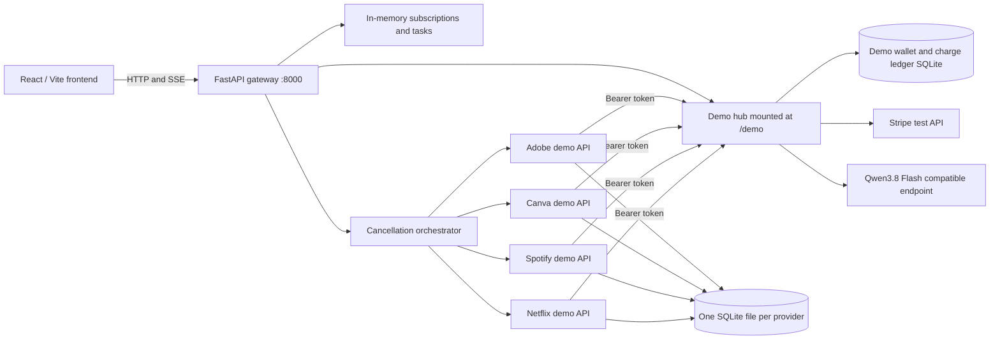

# SubSlayer AI — Software Design

**Status:** implemented hackathon demo, as represented by this repository. This document describes the running design and its boundaries; the [product requirements](product_requirements_document.md) and [backend execution plan](BACKEND_EXECUTION_PLAN.md) describe goals and team ownership.

## Purpose and scope

SubSlayer lets a presenter inspect recurring subscriptions, ask one of four **demo** provider APIs to cancel a subscription, and test a payment-control flow with Stripe test mode. Netflix, Spotify, Canva, and Adobe are independent provider-shaped simulators. Their receipts prove a simulator response, never a change to a real platform account. The product does not use Playwright, Chromium, consumer login automation, real bank feeds, or real virtual cards.

The currently shipped interface is an open demo, with no account authentication. It shows seeded and user-added subscription records, computed spending metrics, provider reachability, cancellation progress, Qwen analysis on demand, and a Stripe test Payment Shield. The backend also has a CSV statement-upload endpoint; the current dashboard is centered on its subscription and provider flows.

## System layout

- **Frontend:** `Figma Design/` is a React 19, TypeScript, Vite 8, Tailwind CSS v4 app. Its only API target is the gateway, configured with `VITE_API_URL` (default `http://127.0.0.1:8000`). The landing page is `/`; the dashboard is `/#app`.
- **Gateway:** `backend/app/main.py` exposes the frontend contract, validates requests, routes cancellation to the matching provider, manages demo card policy, and mounts the hub at `/demo`. Run one worker for the current in-memory state and SQLite locking model.
- **Providers:** Four instances of `backend/app/provider_server.py` run with distinct `PROVIDER_NAME` and `PROVIDER_DB_PATH` values. The gateway uses `NETFLIX_API_URL`, `SPOTIFY_API_URL`, `CANVA_API_URL`, and `ADOBE_API_URL` to reach them. They can live on four devices; localhost ports 8101–8104 work for a one-computer rehearsal.
- **Hub:** `backend/app/demo_hub.py` owns the local demo wallet and charge ledger, calls Stripe test mode for approved charges, and offers Qwen analysis. Provider-to-hub calls use `DEMO_SERVICE_TOKEN`; secrets stay server-side.

## Interface and visual design

The landing page explains the provider-API demo and shows a small live dashboard preview. The dashboard has four sections: **Overview**, **Subscriptions**, **Cancellation history**, and **Virtual cards shield**. Overview derives monthly spend, savings, counts, insights, and upcoming renewals from gateway subscriptions. Subscription rows support search, category filtering, adding/editing records, and cancellation for supported, reachable providers. Cancellation history shows cancelled and pending records with provider evidence. The Payment Shield shows card-policy state, test-charge outcomes, and the local customer demo wallet.

The interface uses a light paper background (`#faf9f6`), dark ink (`#302b32`), plum action color (`#72556e`), lilac accents (`#e9e1ed`), fine borders, and white surfaces. DM Sans is the body font; Manrope is used for headings and the brand. Buttons, dialogs, cards, status badges, and visible keyboard focus styles are defined in `Figma Design/src/index.css`. Responsive layouts keep the dashboard usable on smaller screens.

Every action must show its **demo/test-mode** context. A gateway failure leaves last-known data visibly stale and pauses actions. The frontend refreshes subscriptions, cards, and provider health about every five seconds while visible; the Payment Shield also refreshes the wallet. Displayed amounts are calculated from returned subscriptions or wallet responses, rather than hard-coded dashboard totals. The four seeded provider plan prices are fixed demo contract values.

## Data ownership and states

| Data | Source of truth | Persistence / behavior |
| --- | --- | --- |
| Subscription list and cancellation tasks | Gateway repository | In memory; six records are seeded on startup. User-added records, edits, and task logs do not survive a gateway restart. |
| Supported provider status and receipt | Corresponding provider simulator | Each provider has its own SQLite file. `GET /api/subscriptions?refresh=true` reconciles status, request ID, and effective date after a gateway restart. |
| Card lock and spending limit | Gateway demo policy | Three seeded card-policy records; lock changes are in memory. These are display/test policies, not Stripe-issued virtual cards. |
| Customer demo wallet and charge ledger | Demo hub SQLite | Persistent with a persistent DB path. A successful test charge debits this local wallet once per idempotency key. |
| Stripe merchant test balance | Stripe test account | Exposed separately by `GET /api/stripe/test-balance`; it is **not** the customer wallet and is not expected to decrease on a customer charge. |
| AI explanation | Qwen response | Advisory text requested on demand. It never determines cancellation state, Stripe charge amount, or savings. |

Subscription states are **Active**, **Pending Cancellation**, and **Cancelled**. A submitted request first makes the gateway record pending; only a provider response or subsequent status lookup can establish cancellation. Canva's demo cancellation is immediate; Netflix and Spotify return scheduled outcomes; Adobe returns pending. Generic records such as Notion and iCloud contribute to spending totals but have no cancellation adapter.

## Cancellation journey

1. The user chooses a supported active subscription. The dialog displays provider, plan, projected annual savings, and a warning that only the simulator will change.
2. Confirmation sends `POST /api/agent/cancel` with `subscriptionId`, `provider`, `confirmation: true`, and a unique `idempotencyKey`. The gateway checks provider ownership and queues a task.
3. `GET /api/agent/stream/{taskId}` starts the worker and streams validation, submission, response, and receipt steps as SSE events. The worker continues if the browser stream disconnects after it starts.
4. The provider simulator processes an idempotent cancellation request and returns its request ID, outcome, and effective date when applicable. The gateway updates the subscription based on that response and returns an `agent_completed` event. A scheduled or pending result stays pending; an immediate cancellation becomes cancelled.
5. The UI displays the exact demo-provider result and receipt. If SSE drops, it asks `GET /api/agent/tasks/{taskId}` for a recoverable result. A retry of the same operation reuses its idempotency key. Periodic `refresh=true` lookups reconcile later provider status.

The gateway must not label a timeout, rejected request, or unavailable provider as a confirmed cancellation. Projected savings are estimates, not money already recovered.

## Payment Shield journey

1. The UI gets demo cards from `GET /api/cards` and the customer wallet from `GET /api/demo-wallet`. A lock toggle calls `POST /api/cards/toggle-lock`.
2. A test charge calls `POST /api/cards/simulate-charge` with card ID, merchant, exact provider demo amount, and idempotency key. The gateway checks lock, supported merchant, amount, and spending limit first. A blocked charge never creates a Stripe PaymentIntent and does not debit the wallet.
3. An allowed charge goes through the hub to a Stripe **test-mode** PaymentIntent. The hub records the result in its SQLite ledger. On success it decreases the separate local customer wallet exactly once; on decline it preserves/restores the wallet. The same key must be reused after an uncertain response.
4. The UI shows blocked, succeeded, or declined outcomes from the backend and refreshes wallet balance. The Stripe merchant test balance is a separate diagnostic view.

This is a payment demonstration, not a bank account, stored-value Stripe account, actual card issuance, or a guarantee that a real merchant payment would be stopped.

## AI and statement analysis

`POST /api/ai/analyze` sends subscription context to Qwen3.8 Flash through an OpenAI-compatible Chat Completions endpoint. The gateway keeps `QWEN_API_KEY` on the backend. The UI requests this explanation on demand and presents it as advice. Scoring and cost normalization are deterministic backend functions; the model is not the source of transaction or provider truth.

`POST /api/statement/upload` parses a CSV statement into recurring subscription candidates and spending metrics. This ingestion route is available for the backend flow, while the current demo dashboard primarily uses seeded and added subscriptions. Imported or added gateway records currently share the in-memory persistence limit above.

## Public gateway contract

| Area | Endpoints | UI purpose |
| --- | --- | --- |
| Status | `GET /health`, `GET /api/providers/{name}/health` | Gateway/test-mode status and per-provider reachability. |
| Subscriptions | `GET /api/subscriptions?refresh=true`, `POST /api/subscriptions`, `PATCH /api/subscriptions/{id}` | List/reconcile, add, and edit subscriptions. |
| Cancellation | `POST /api/agent/cancel`, `GET /api/agent/stream/{taskId}`, `GET /api/agent/tasks/{taskId}` | Submit once, watch SSE, recover task result. |
| Payment | `GET /api/cards`, `POST /api/cards/toggle-lock`, `POST /api/cards/simulate-charge`, `GET /api/demo-wallet`, `GET /api/stripe/test-balance` | Demo policy, Stripe test charges, and separate balances. |
| Analysis | `POST /api/ai/analyze`, `POST /api/statement/upload` | Qwen explanation and CSV ingestion. |

Provider and hub endpoints under `/demo/api/*` are service-to-service interfaces, not browser APIs. Use the backend's generated OpenAPI page for field-level request and response schemas.

## Deployment, security, and verification

Run the frontend, one gateway, and four provider processes as described in [backend/README.md](backend/README.md). Put Stripe's `sk_test_...` key, Qwen key, provider URLs, and a long random service token in ignored backend environment configuration; never put them in `VITE_` variables or commit them. Give provider devices only their provider name, DB path, hub URL, and shared service token. Configure the frontend origin in `CORS_ORIGINS`. Use a trusted LAN/VPN for the device demo, or HTTPS/private tunnels across untrusted networks. The open demo and service token are not a production user-authentication design.

The minimum end-to-end check is: all four provider health routes respond; subscription refresh reflects provider state; one cancellation produces a receipt with the correct pending/cancelled status; a locked charge leaves the wallet unchanged; an allowed successful Stripe test charge decreases the local wallet once, including after an idempotent retry; and Qwen analysis appears as advisory text. Backend integration tests and frontend type/build checks are described in [backend/README.md](backend/README.md).

**Current constraints:** Gateway memory is lost on restart; provider and wallet SQLite must use persistent paths for a multi-session demo. Provider devices and Stripe/Qwen calls require network reachability for those live paths. The fixture mode is an explicit offline backend option (`PROVIDER_MODE=fixture`), while the four-device demonstration uses `PROVIDER_MODE=remote`. Production use would require real user authentication, durable task/subscription storage, provider-authorized integrations, and a separately designed payment control product.
