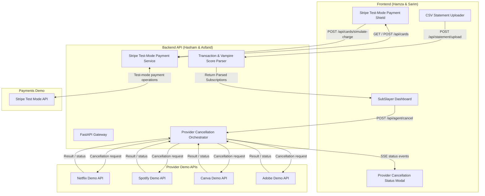

# SubSlayer AI — Master Product Requirements Document (PRD) & Team Playbook
> **Hackathon Track:** AI Agents / FinTech / Financial Operations
> **Version:** 2.1 (Provider API Demo Architecture)
> **Team Size:** 5 Members + 3 Documentation Agent Roles
> **Project Goal:** Build and demonstrate a subscription management system that detects likely waste, sends cancellation requests to four realistic provider demo APIs, and demonstrates Stripe test-mode payment flows. The demo uses no browser automation or Chromium.
---
## Table of Contents
1. [Executive Summary & The "Why"](#1-executive-summary--the-why)
2. [Team Roster, Ownership & AI Handoffs](#2-team-roster-ownership--ai-handoffs)
3. [System Architecture & Data Flow](#3-system-architecture--data-flow)
4. [Feature Specifications](#4-feature-specifications)
   - [Feature 1 (P0 - Core MVP): Provider API Cancellation Orchestrator](#feature-1-p0---core-mvp-provider-api-cancellation-orchestrator)
   - [Feature 2 (P1 - High Priority): Stripe Test-Mode Payment Shield Demo](#feature-2-p1---high-priority-stripe-test-mode-payment-shield-demo)
   - [Feature 3 (P0 - Foundation): Bank Feed Ingestion & Vampire Detector](#feature-3-p0---foundation-bank-feed-ingestion--vampire-detector)
5. [Frontend <-> Backend API Contracts (Shared Spec)](#5-frontend---backend-api-contracts-shared-spec)
6. [Talal's Pitch, Research & Presentation Master Kit](#6-talals-pitch-research--presentation-master-kit)
7. [Sub-Team AI Prompts (Copy & Paste Ready)](#7-sub-team-ai-prompts-copy--paste-ready)
   - [Prompt for Hamza & Sarim (Frontend)](#prompt-for-hamza--sarim-frontend)
   - [Prompt for Hasham & Asfand (Backend)](#prompt-for-hasham--asfand-backend)
   - [Prompt for Talal (Pitch & Research)](#prompt-for-talal-pitch--research)
8. [Agent Handoffs](#agent-handoffs-documentation-only-roles)
9. [Hackathon Milestones & Risk Fallback Playbook](#9-hackathon-milestones--risk-fallback-playbook)
---
## 1. Executive Summary & The "Why"
### The Problem
- **The Perception Gap:** The average consumer estimates they spend **$86/month** on subscriptions, but their actual spending averages **$219/month** (over **$2,600/year**).
- **Zombie Spend:** **42% of consumers** continuously pay for subscriptions they haven't used in months or completely forgot about.
- **The Cancellation Moat (Dark Patterns):** Companies spend millions designing retention mazes ("Roach Motels"): hiding cancel links behind 6 nested settings pages, forcing "Confirm cancellation" through 4 manipulative discount modals, or requiring human phone calls during limited hours.
- **The Failure of Current Tools:** Apps like Rocket Money or Truebill are **passive trackers**; when you want to cancel, they either submit an internal concierge ticket that takes 3–5 business days, or send you an email link telling you to do it yourself.
### The SubSlayer Solution
SubSlayer AI transforms subscription management from **passive visibility** to **automated provider API action**:
1. **Detects:** Ingests statements and flags high-risk "vampire" subscriptions with annualized financial drain metrics.
2. **Provider API cancellation:** With one click, the backend sends a request to the selected provider's demo API. Four provider simulators (Netflix, Spotify, Canva, and Adobe) return realistic outcomes and status updates. The interface identifies these as demo integrations.
3. **Stripe test-mode payments:** The demo uses Stripe test mode to exercise payment-method and payment-intent flows without moving real money. A local demo policy can simulate locking a payment method; this is not a real stored-value account or a guarantee about a real bank account.
---
## 2. Team Roster, Ownership & AI Handoffs
| Member(s) | Role & Ownership | Primary Tech Stack | Core Deliverables |
| :--- | :--- | :--- | :--- |
| **Hamza & Sarim** | **Frontend & UI/UX** | React 19, Vite, Tailwind CSS v4, Lucide Icons (Based on `Figma Design/`) | • Rebrand Figma prototype (`Unloop` -> `SubSlayer AI`)<br>• Connect UI to backend APIs<br>• Build the **Cancellation Run Modal** (provider request steps, response and status updates)<br>• Build the **Payment Shield Screen** (Stripe test-mode state, local demo lock control, test charge outcome) |
| **Hasham & Asfand** | **Backend, Provider Integrations & Payments** | Python (FastAPI / Uvicorn), Pydantic, HTTP clients, Stripe test mode, SSE | • CSV ingestion & Vampire Score algorithm<br>• Four provider demo API adapters and deterministic fixtures<br>• Cancellation orchestration, idempotency, audit records and status events<br>• Stripe test-mode customer/payment method/payment intent integration<br>• Payment Shield API and safe demo charge outcomes |
| **Talal** | **Pitch, Deep Problem Research & Live Demo** | Slide Deck (Figma / Pitch / Slides), Script, Rehearsal, Backup Video | • Deep data gathering (subscription cancellation rules, waste stats, dark pattern taxonomy)<br>• 5-Minute Pitch Script with timed cues<br>• Rehearsal & delivery fluency<br>• Screen recording backup of the provider API and Stripe test-mode demo |
---
## 3. System Architecture & Data Flow

---
## 4. Feature Specifications
### Feature 1 (P0 - Core MVP): Provider API Cancellation Orchestrator
#### 1. The Trigger
- The dashboard lists supported subscriptions and offers a **"Request cancellation"** action for each active one.
- Before sending, the user sees provider, plan, projected savings, and a clear label that the integration is a demo.
#### 2. Provider API Execution
1. **Provider selection:** Map each subscription to one adapter: Netflix, Spotify, Canva, or Adobe. Unknown providers return `unsupported_provider`.
2. **Demo request:** Send the confirmed request to the provider demo API with an idempotency key and internal subscription reference. Use configured demo URLs and non-production credentials.
3. **Deterministic outcomes:** Simulators support immediate, scheduled, pending, already-cancelled, rejected, timeout, and unavailable outcomes using fixtures for reliable demos.
4. **Verification and audit:** Read status from the demo API and record request ID, provider, timestamps, outcome, effective date, and sanitized response summary. This is API-level demo evidence, not proof that a real account changed.
5. **Safety boundary:** Never call production consumer endpoints or claim real subscriptions changed. Production integrations require official provider authorization and supported APIs.
#### 3. Provider Demo API Set
The demo supports exactly four provider simulators: **Netflix, Spotify, Canva, and Adobe**. Each supports subscription lookup, cancellation request, and status lookup. These are provider-shaped demos, not official production APIs. Local deterministic adapters must work without external connectivity.
#### 4. Real-Time UI Feedback
- The frontend receives SSE at `/api/agent/stream/{taskId}` or polls task status. Show request validation, provider submission, response, and status verification.
- On success, show a receipt with provider, request ID, outcome, effective date, and projected savings. Update subscription state only from the provider response.
- For pending, already-cancelled, rejected, timeout, and unavailable outcomes, display the returned state and next action. Never show success unless the response supports it.
---
### Feature 2 (P1 - High Priority): Stripe Test-Mode Payment Shield Demo
This feature demonstrates payment controls in Stripe test mode. It does not issue a real virtual card, hold real balances, or guarantee protection for a real bank account. Never collect or store raw card numbers or CVVs; use Stripe test payment method tokens or Stripe-hosted test flows.
#### 1. Why this Feature is a Useful Demo
- It demonstrates payment controls for subscriptions that remain active after a cancellation request.
- Stripe test mode exercises payment flows without moving real money.
#### 2. Stripe Test-Mode Demo Capabilities
1. Create or reuse a Stripe test Customer; store Stripe IDs and safe display metadata only.
2. Attach a test PaymentMethod through Stripe test or hosted setup flow. Never accept PAN or CVV in SubSlayer endpoints.
3. A local demo-policy toggle can block a simulated attempt. When unlocked, create a Stripe test-mode PaymentIntent or test invoice. Stripe test mode does not provide a real virtual-card balance-zero control.
4. Label outcomes `blocked_by_demo_policy` or `declined_by_stripe`; show test-mode status and object ID.
5. Require an `sk_test_` key and validate test mode. Never enable live keys for this demo; verify webhook signatures if webhooks are used.
---
### Feature 3 (P0 - Foundation): Bank Feed Ingestion & Vampire Detector
1. **Ingestion:**
   - Provides a "Upload Bank Statement (CSV)" button or a "Load Demo Statement" shortcut.
   - Supported sample CSV format: `Date, Merchant, Amount, Category`.
2. **AI Vampire Score Calculation:**
   - Detects recurring amounts and frequency (monthly/annual).
   - Assigns a **Vampire Score (0–100)** based on:
     - High renewal cost.
     - Unused status (e.g., no activity linked).
     - Recent unannounced price hike.
   - Highlights total annualized spend: e.g., "$111.46/mo = $1,337.52/year".
---
## 5. Frontend <-> Backend API Contracts (Shared Spec)
Frontend and backend should use these shared schemas for consistent integration.
### 1. Subscriptions Endpoint
`GET /api/subscriptions`
```json
[
  {
    "id": "sub_01",
    "name": "Adobe Creative Cloud",
    "category": "Productivity",
    "price": 59.99,
    "cycle": "Monthly",
    "renewal": "2026-06-28",
    "status": "Active",
    "vampireScore": 88,
    "provider": "adobe",
    "providerSubscriptionId": "demo_adobe_sub_01",
    "latestCancellationTaskId": null
  }
]
```
`POST /api/subscriptions`
```json
{
  "provider": "netflix",
  "name": "Netflix",
  "category": "Entertainment",
  "price": 15.49,
  "cycle": "Monthly",
  "renewal": "2026-06-24"
}
```
### 2. Provider Cancellation Orchestration Endpoints
`POST /api/agent/cancel`
```json
// Request Body
{
  "subscriptionId": "sub_01",
  "provider": "canva",
  "confirmation": true,
  "idempotencyKey": "cancel-sub_01-20261010"
}
// Immediate Response (HTTP 202 Accepted)
{
  "taskId": "task_cancel_9823",
  "status": "queued",
  "streamUrl": "/api/agent/stream/task_cancel_9823"
}
```
`GET /api/agent/stream/{taskId}` (Server-Sent Events - SSE)
```
event: agent_step
data: {"step": 1, "total": 4, "message": "Validated subscription and provider demo integration", "timestamp": "10:48:02"}
event: agent_step
data: {"step": 2, "total": 4, "message": "Sent cancellation request to Canva demo API", "timestamp": "10:48:09"}
event: agent_step
data: {"step": 3, "total": 4, "message": "Received provider response: scheduled for period end", "timestamp": "10:48:17"}
event: agent_completed
data: {
  "status": "success",
  "subscriptionId": "sub_01",
  "provider": "canva",
  "providerRequestId": "demo_canva_req_7312",
  "providerStatus": "cancellation_scheduled",
  "effectiveDate": "2026-06-28",
  "message": "Cancellation scheduled by Canva demo API",
  "projectedAnnualSavings": 719.88,
  "evidenceType": "provider_demo_api_response"
}
```
Supported providers are `netflix`, `spotify`, `canva`, and `adobe`. Task states are `success`, `pending`, `already_cancelled`, `rejected`, and `failed`. Each adapter implements subscription lookup, cancellation request, and status lookup. `GET /api/agent/tasks/{taskId}` returns current and final state if SSE disconnects. These are demo integrations, not official production APIs.
### 3. Stripe Test-Mode Payment Shield Endpoints (Feature 2)
`GET /api/cards`
```json
[
  {
    "id": "card_01",
    "label": "Streaming demo",
    "stripeCustomerId": "cus_test_123",
    "paymentMethodId": "pm_card_visa",
    "cardBrand": "visa",
    "last4": "4242",
    "testMode": true,
    "spendingLimit": 20.00,
    "demoPolicyLocked": true,
    "status": "locked"
  }
]
```
Stripe test payment methods are fixtures, not real issued virtual cards. Never store or return PAN/CVV. `POST /api/cards` creates or attaches a test payment method and stores Stripe IDs plus safe display data only.
`POST /api/cards/toggle-lock` accepts `{"cardId":"card_01","locked":true}` and returns updated local demo policy state.
`POST /api/cards/simulate-charge`
```json
// Request Body
{
  "cardId": "card_01",
  "amount": 59.99,
  "merchant": "Adobe Systems",
  "idempotencyKey": "charge-card_01-20261010"
}
// Response
{
  "success": false,
  "status": "DECLINED",
  "reason": "Payment blocked by SubSlayer demo policy; no Stripe payment was created",
  "outcomeType": "blocked_by_demo_policy",
  "stripePaymentIntentId": null,
  "testMode": true,
  "amountBlocked": 59.99,
  "timestamp": "2026-10-10T10:48:30Z"
}
```
When unlocked, the backend may create a Stripe test-mode PaymentIntent. Return explicit outcomes `blocked_by_demo_policy`, `succeeded`, or `declined_by_stripe`, always with `testMode:true`. Never claim that test mode proves a real bank account was protected. Verify webhook signatures and process webhook updates idempotently.
### 4. Environment and Demo Configuration
- `STRIPE_SECRET_KEY` must begin with `sk_test_`; never enable live keys in the demo.
- `STRIPE_WEBHOOK_SECRET` is optional for local webhook handling.
- `PROVIDER_DEMO_MODE=true` enables deterministic provider fixtures.
- Optional simulator URLs: `NETFLIX_DEMO_API_BASE_URL`, `SPOTIFY_DEMO_API_BASE_URL`, `CANVA_DEMO_API_BASE_URL`, `ADOBE_DEMO_API_BASE_URL`. Unset values select local adapters.
- Keep demo credentials in environment variables. No production consumer credentials or cookies are used.
---
## 6. Talal's Pitch, Research & Presentation Master Kit
*Talal's mission is to win the presentation. Even the best code loses without a captivating story, concrete statistics, and a bulletproof live demo.*
### 1. Concrete Research & Evidence
Use these exact numbers and authoritative sources during the opening hook:
- **The $133 Gap:** According to C+R Research, consumers believe they spend **$86/month** on subscriptions, but actual bank statements reveal an average of **$219/month**—a **$1,596/year** invisible drain.
- **Zombie Subscriptions:** Bankrate reports that **42% of consumers** are paying for subscriptions they have completely forgotten about or no longer use.
- **The Roach Motel Dark Pattern:** Defined by Princeton University's dark patterns research: services make signup 1-click, but cancellation requires 6–8 distinct clicks, misleading confirmation buttons, hidden cancellation links, and mandatory questionnaires.
- **Regulatory context:** Discuss current subscription cancellation rules accurately. This demo does not enforce regulations or change real provider accounts.
### 2. The 5-Minute Pitch Structure (Second-by-Second Script)
```
[0:00 - 0:45] THE HOOK (Talal)
"Raise your hand if you've ever signed up for a 7-day free trial, forgot to cancel, and paid for it for the next 6 months?
You are not alone. Americans bleed over $2,600 a year on subscriptions they thought cost $86 a month.
Why? Because companies weaponized UX. They make signing up 1-click, and cancellation an obstacle course of retention mazes, hidden links, and discount bribes.
Existing apps like Rocket Money just send you an email telling you to go suffer through the cancellation yourself.
Today, we are changing that. Meet SubSlayer AI: a clear way to manage recurring subscriptions."
[0:45 - 1:45] THE PROBLEM & ARCHITECTURE (Talal)
"SubSlayer gives users a clear way to act on recurring charges:
First, it sends cancellation requests to one of four provider demo APIs—Netflix, Spotify, Canva, or Adobe—and shows the returned status and effective date.
Second, Stripe test mode demonstrates payment flows without moving real money. A local demo policy illustrates a possible payment control.
Let's see it live."
[1:45 - 3:30] THE LIVE DEMO (Talal + Screen Choreography)
1. "Here is the SubSlayer Dashboard. We load a sample bank statement and see recurring subscriptions with estimated annual costs."
2. "For Canva Pro, I confirm the cancellation request. SubSlayer sends it to the Canva demo API."
3. [Cancellation status modal shows provider request and response events]
   "The backend validates the subscription, sends the provider request, and receives a scheduled cancellation date. The same flow is available for Netflix, Spotify, and Adobe demo APIs."
4. [Provider response receipt appears on dashboard]
   "The dashboard records the provider request ID and effective date. Savings are projected from the provider response."
5. (If the Stripe payment demo is ready - 30 seconds):
   "Now we switch to Stripe test mode. We lock the local demo policy and simulate a $59.99 payment. The UI shows whether our policy blocked it or Stripe returned a test decline. No real money moves."
[3:30 - 4:15] BUSINESS MODEL & MARKET OPPORTUNITY (Talal)
"Business model hypothesis: validate market sizing and pricing before presenting.
Monetization:
1. Freemium: 3 free cancellation requests/mo; $4.99/mo for unlimited requests and payment controls.
2. Value-Share: explore only if savings can be verified and the model is validated.
3. Future payment revenue: evaluate compliant partnerships if a production card product is pursued; this test-mode demo generates no interchange revenue."
[4:15 - 5:00] CONCLUSION & Q&A OPENING (Talal)
"SubSlayer AI helps people move from passive tracking to clear, provider-reported cancellation outcomes.
Thank you, and we'd love to take your questions!"
```
### 3. Judges' Q&A Defense Battlecard
- **Judge: "Do you log in to real provider accounts?"**
  - *Talal's Answer:* "No. This demo uses provider-shaped APIs and does not access real consumer accounts. Production use would require official provider authorization."
- **Judge: "What if a provider changes its API?"**
  - *Talal's Answer:* "Each provider has an isolated adapter and explicit contract. These hackathon adapters use deterministic demo services; production integrations would need monitoring and maintenance."
- **Judge: "Does Stripe test mode issue a real virtual card or lock its balance?"**
  - *Talal's Answer:* "No. Stripe test mode uses test payment methods. The lock in our UI is a local demo policy, not a real card or bank control."
---
## 7. Sub-Team AI Prompts (Copy & Paste Ready)
Each sub-team can use the following prompt as its role brief. The agent handoffs below are documentation-only roles.
---
### Prompt for Hamza & Sarim (Frontend)
```markdown
You are pair programming with Hamza and Sarim on the frontend of SubSlayer AI, a provider API cancellation demo for a hackathon.
Our existing repository already contains a Figma-exported React 19 + Vite + Tailwind CSS project located in `Figma Design/`.
Currently, the prototype uses the brand "Unloop" and simulates cancellations with a local timer stepper.
Your goals:
1. Brand Alignment:
   - Update branding from "Unloop" to "SubSlayer AI" across the landing page, navigation, and dashboard.
   - Retain the clean, sleek financial aesthetic, modern typography, and polish.
2. Connect Real API State:
   - Replace hardcoded seed data with state fetched from `http://localhost:8000/api/subscriptions`.
   - Implement bank statement CSV upload button (`POST /api/statement/upload`) or a 1-click "Load Sample Bank Data" demo button that loads realistic transactions.
3. Provider Cancellation Status Modal:
   - Replace the simulated timeout modal with a real-time provider request status view.
   - On user confirmation, call `POST /api/agent/cancel` with `{ subscriptionId, provider, confirmation, idempotencyKey }`.
   - Stream events from `/api/agent/stream/{taskId}` and show request validation, provider submission, response, and status verification.
   - Show provider request ID, outcome, and effective date. Update subscription state and projected savings only from the provider response.
4. Stripe Test-Mode Payment Shield Demo:
   - Add a "Payment Shield (Demo)" navigation item.
   - Show Stripe test-mode metadata (brand and last four only; never PAN or CVV).
   - Include a local demo-policy lock toggle and test charge action at `POST /api/cards/simulate-charge`.
   - Distinguish local policy blocks from Stripe test declines and label every result as test mode.
Please inspect `Figma Design/src/App.tsx` and return an implementation plan; this prompt does not request implementation code.
```
---
### Prompt for Hasham & Asfand (Backend)
```markdown
You are pair programming with Hasham and Asfand on the SubSlayer API backend. Do not implement browser automation, Chromium, cookie injection, or website navigation.
We need a Python FastAPI server running on `http://localhost:8000` with CORS enabled for `http://localhost:5173` and `http://localhost:8443`.
Your deliverables:
1. Server & Endpoints (`main.py`):
   - `GET /api/subscriptions`: Return subscriptions with provider, providerSubscriptionId, plan/price/status fields, vampireScore, and latest task state.
   - `POST /api/subscriptions`: Add custom subscription.
   - `POST /api/statement/upload`: Accept CSV or provide mock bank CSV parser that calculates recurring monthly drain and Vampire Score (0-100).
   - `POST /api/agent/cancel`: Sends a confirmed request to the selected provider demo API; returns `{ taskId, status, streamUrl }`.
   - `GET /api/agent/stream/{taskId}` and `GET /api/agent/tasks/{taskId}`: stream and retrieve provider request progress/results.
   - `GET /api/cards`: Return safe Stripe test-mode metadata only.
   - `POST /api/cards/toggle-lock`: Toggle the local demo policy state.
   - `POST /api/cards/simulate-charge`: Locally blocks locked attempts or creates a Stripe test PaymentIntent when unlocked.
2. Provider Demo API Adapters:
   - Implement four separate simulators/adapters: Netflix, Spotify, Canva, and Adobe. They imitate provider APIs and must never call production consumer endpoints.
   - Support subscription lookup, cancellation request, and status lookup with typed request/response contracts, idempotency keys, safe timeouts, and explicit outcomes.
   - Include fixtures for immediate, scheduled, pending, already-cancelled, rejected, timeout, and unavailable results.
   - Persist sanitized audit records, stream status events through SSE, and expose task retrieval for reconnects.
3. Stripe Test Mode:
   - Require an `sk_test_` Stripe secret; validate test mode. Never accept or store PAN/CVV and never use live mode in this demo.
   - Implement test customer/payment method setup, local demo-policy lock/unlock, and test PaymentIntent flow. Verify webhooks if used.
4. Resilience & Demo Mode:
   - Local provider adapters must work without internet and preserve a deterministic presentation path.
Please implement a modular backend using `provider_adapters.py`, `stripe_service.py`, `models.py`, and `main.py`.
```
---
### Prompt for Talal (Pitch & Research)
```markdown
You are the Pitch and Research Lead for SubSlayer AI, a subscription product with provider-shaped demo APIs and a Stripe test-mode payment demo.
Your mission:
1. Deep-Dive Research & Evidence:
   - Provide concrete, verified statistics on consumer subscription waste (C+R Research, Bankrate, FTC).
   - Summarize relevant cancellation rules accurately; do not claim this demo enforces laws or changes real accounts.
   - Document real-world examples of dark patterns (Adobe's hidden exit fees, Amazon Prime's 6-step cancellation flow).
2. Presentation Slide Deck Plan:
   - Create a 6-to-7 slide pitch deck outline (Hook, Problem, Solution, Live Demo cue, Business Model, Roadmap/Vision).
   - For each slide, write the slide title, key bullet points, visual layout recommendations, and exact speaking script.
3. Demo Rehearsal Script:
   - Write a word-for-word, timed script (exactly 5 minutes) designed for high energy and clarity.
   - Include visual cues for when Hamza, Sarim, Hasham, or Asfand should click buttons on screen.
   - Formulate a contingency plan: what to say if provider simulators or venue Wi-Fi encounter latency, seamlessly transitioning to a pre-recorded backup video.
4. Judges' Q&A Cheat Sheet:
   - Prepare answers to tough questions on provider authorization, demo versus production APIs, Stripe test mode, privacy, monetization, and payments regulation.
```
---
## 8. Agent Handoffs (Documentation-Only Roles)
These are role briefs to assign to AI agents or teammates; they are documentation only and do not create or deploy agents.
### Agent 1 — Documentation Review Agent
Read the full PRD and report findings only. Check consistency across requirements, architecture, API contracts, prompts, pitch, milestones, and risks. Confirm four demo providers (Netflix, Spotify, Canva, Adobe), no browser automation path, Stripe test mode only, and no claims about real account/card/bank outcomes. Report prioritized issues with section names and suggested edits. Do not change files or write code.
### Agent 2 — Black-Box Test Agent (No Project Context)
**Context boundary:** Give this agent only this brief and the running service base URL. Do not give it this PRD, repository, source code, or architecture. It should infer behavior from HTTP requests and responses only.
**Brief:** Test the service against this contract. Report request, expected result, observed result, and reproducible defects. Use demo data and safe test amounts; do not alter service configuration.
**Contract:**
- `GET /api/subscriptions` returns an array with `id`, `provider`, `name`, `price`, `cycle`, `renewal`, and `status`.
- `POST /api/agent/cancel` accepts `{subscriptionId, provider, confirmation:true, idempotencyKey}` and returns HTTP 202 with `{taskId, status:"queued", streamUrl}` for a valid request.
- `GET /api/agent/tasks/{taskId}` returns task state. Terminal states are `success`, `pending`, `already_cancelled`, `rejected`, or `failed`; include provider request ID/effective date when available.
- `GET /api/agent/stream/{taskId}` streams progress and a terminal event; unknown task returns clear not-found response.
- `GET /api/cards` returns safe metadata only. Full card number and CVV must never appear.
- `POST /api/cards/toggle-lock` accepts `{cardId, locked:boolean}` and returns updated demo-policy state.
- `POST /api/cards/simulate-charge` accepts `{cardId, amount:positive number, merchant, idempotencyKey}` and returns `blocked_by_demo_policy`, `succeeded`, or `declined_by_stripe`, with `testMode:true`.
- `POST /api/statement/upload` accepts CSV and returns parsed subscriptions/totals or a clear validation error.
**Minimum checks:** valid/invalid payloads, missing confirmation, unknown subscription/provider/task/card, duplicate idempotency keys, locked/unlocked payment, non-positive amount, malformed/empty CSV, SSE task retrieval after disconnect, and no secrets/full card data in responses or errors.
### Agent 3 — Integration Plan Agent
Read the PRD and return a dependency-ordered backend/frontend integration plan covering provider adapter contracts, deterministic fixtures and failure states, SSE and task retrieval, Stripe test-mode setup and secrets, UI loading/pending/error/success states, and demo rehearsal. Flag PRD mismatches. Do not modify code.
---
## 9. Hackathon Milestones & Risk Fallback Playbook

### Time Checkpoints (24-Hour Hackathon Model)

```
[Hours 0 - 3]   ALIGNMENT & CONTRACT FREEZE
                • Review this PRD and agree on API contracts.
                • Frontend starts Vite; backend starts FastAPI, four provider demo adapters, and Stripe test mode.
                • Pitch owner validates evidence and outlines the demo.

[Hours 3 - 10]  CORE FEATURE BUILD
                • Backend: subscriptions, CSV ingestion, provider cancellation adapters, Stripe test service.
                • Frontend: SubSlayer branding, provider cancellation status modal, REST/SSE integration.
                • Pitch: first script draft.

[Hours 10 - 16] INTEGRATION & PAYMENT DEMO
                • Connect SSE and task retrieval; verify provider responses and failure states.
                • Implement Stripe test-mode payment UI and local demo policy.
                • Capture a provider API cancellation receipt.

[Hours 16 - 20] DEMO HARDENING
                • Record provider API and Stripe test-mode demo.
                • Verify local deterministic adapters work without internet.
                • Rehearse the pitch.

[Hours 20 - 24] PRESENTATION
                • Rehearse, polish slides, and prepare local demo fallback.
```

### Risk & Fallback Matrix

| Risk Scenario | Likelihood | Impact | Built-in Mitigation |
| :--- | :--- | :--- | :--- |
| **Provider simulator is slow or unavailable** | Medium | High | Use local deterministic adapters and show explicit unavailable/pending states for remote failures. |
| **Running out of time during hackathon** | Medium | Medium | Provider API cancellation is P0. Keep Stripe test-mode payment UI as a secondary demo. |
| **Stripe test configuration fails** | Medium | Medium | Validate `sk_test_` at startup; report local policy blocks separately from Stripe declines. |
| **Venue Wi-Fi fails or has high latency** | High | Critical | Use local provider adapters and keep a pre-recorded demo available. |
