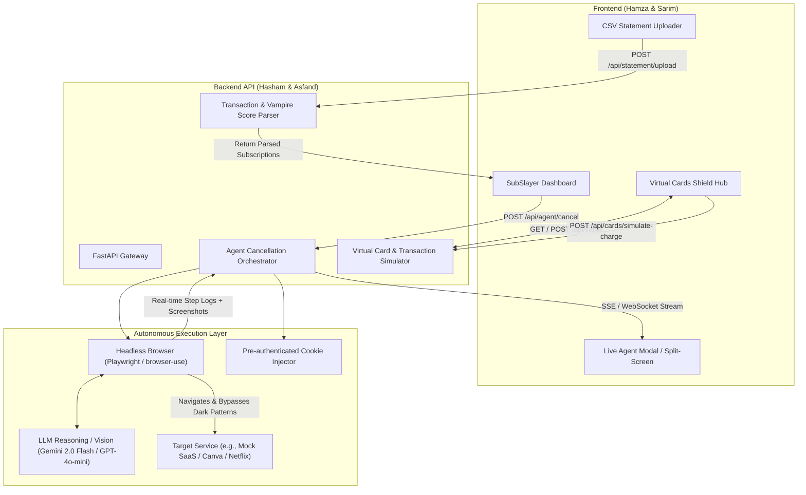

# SubSlayer AI — Master Product Requirements Document (PRD) & Team Playbook

> **Hackathon Track:** AI Agents / FinTech / Financial Operations  
> **Version:** 2.0 (Hackathon Production Master)  
> **Team Size:** 5 Members  
> **Project Goal:** Build and demonstrate an autonomous AI agent that detects "vampire" subscriptions, bypasses dark patterns to physically cancel them, and deploys Privacy.com-style virtual burner cards to shield users' real bank accounts.

---

## Table of Contents
1. [Executive Summary & The "Why"](#1-executive-summary--the-why)
2. [Team Roster, Ownership & AI Handoffs](#2-team-roster-ownership--ai-handoffs)
3. [System Architecture & Data Flow](#3-system-architecture--data-flow)
4. [Feature Specifications](#4-feature-specifications)
   - [Feature 1 (P0 - Core MVP): Autonomous AI Cancellation Agent](#feature-1-p0---core-mvp-autonomous-ai-cancellation-agent)
   - [Feature 2 (P1 - High Priority): Privacy.com-Style Virtual Cards](#feature-2-p1---high-priority-privacycom-style-virtual-cards)
   - [Feature 3 (P0 - Foundation): Bank Feed Ingestion & Vampire Detector](#feature-3-p0---foundation-bank-feed-ingestion--vampire-detector)
5. [Frontend <-> Backend API Contracts (Shared Spec)](#5-frontend---backend-api-contracts-shared-spec)
6. [Talal's Pitch, Research & Presentation Master Kit](#6-talals-pitch-research--presentation-master-kit)
7. [Sub-Team AI Prompts (Copy & Paste Ready)](#7-sub-team-ai-prompts-copy--paste-ready)
   - [Prompt for Hamza & Sarim (Frontend)](#prompt-for-hamza--sarim-frontend)
   - [Prompt for Hasham & Asfand (Backend)](#prompt-for-hasham--asfand-backend)
   - [Prompt for Talal (Pitch & Research)](#prompt-for-talal-pitch--research)
8. [Hackathon Milestones & Risk Fallback Playbook](#8-hackathon-milestones--risk-fallback-playbook)

---

## 1. Executive Summary & The "Why"

### The Problem
- **The Perception Gap:** The average consumer estimates they spend **$86/month** on subscriptions, but their actual spending averages **$219/month** (over **$2,600/year**).
- **Zombie Spend:** **42% of consumers** continuously pay for subscriptions they haven't used in months or completely forgot about.
- **The Cancellation Moat (Dark Patterns):** Companies spend millions designing retention mazes ("Roach Motels"): hiding cancel links behind 6 nested settings pages, forcing "Confirm cancellation" through 4 manipulative discount modals, or requiring human phone calls during limited hours.
- **The Failure of Current Tools:** Apps like Rocket Money or Truebill are **passive trackers**; when you want to cancel, they either submit an internal concierge ticket that takes 3–5 business days, or send you an email link telling you to do it yourself.

### The SubSlayer Solution
SubSlayer AI transforms subscription management from **passive visibility** to **autonomous agentic action**:
1. **Detects:** Ingests statements and flags high-risk "vampire" subscriptions with annualized financial drain metrics.
2. **Sits in the Driver's Seat (AI Agent):** With one click, an autonomous browser agent (`browser-use` / Playwright) launches, logs in via pre-authenticated sessions, intelligently navigates confusing UI mazes, declines retention discounts, and executes the physical cancellation.
3. **The Financial Shield (Virtual Burner Cards):** If a service refuses to cancel or requires a phone call, SubSlayer provides on-demand Privacy.com-style virtual cards. Users can instantly set a card's balance to **$0** or lock it. When the merchant attempts to bill the card, it is immediately declined—leaving the user's main bank account 100% untouched.

---

## 2. Team Roster, Ownership & AI Handoffs

| Member(s) | Role & Ownership | Primary Tech Stack | Core Deliverables |
| :--- | :--- | :--- | :--- |
| **Hamza & Sarim** | **Frontend & UI/UX** | React 19, Vite, Tailwind CSS v4, Lucide Icons (Based on `Figma Design/`) | • Rebrand Figma prototype (`Unloop` -> `SubSlayer AI`)<br>• Connect UI to real backend APIs<br>• Build the **Live Agent Execution Modal / Split-Screen View** (streaming steps + screenshots)<br>• Build the **Virtual Cards Screen** (card visual, spend limit slider, zero-out balance toggle, mock charge simulator) |
| **Hasham & Asfand** | **Backend, AI Agents & Scripting** | Python (FastAPI / Uvicorn), `browser-use` / Playwright, Pydantic, WebSockets/SSE | • CSV ingestion & Vampire Score algorithm<br>• Headless Browser Agent engine with session cookie injection<br>• Dark pattern bypass logic & DOM proof screenshot capture<br>• Virtual Card API service (card generator, balance lock to $0, transaction decline simulator)<br>• Real-time Agent event streamer endpoint |
| **Talal** | **Pitch, Deep Problem Research & Live Demo** | Slide Deck (Figma / Pitch / Slides), Script, Rehearsal, Backup Video | • Deep data gathering (FTC rulings, subscription waste stats, dark pattern taxonomy)<br>• 5-Minute Pitch Script with second-by-second cues<br>• Rehearsal & delivery fluency<br>• High-resolution screen recording backup of the agent executing cancellation in case venue Wi-Fi fails |

---

## 3. System Architecture & Data Flow



---

## 4. Feature Specifications

### Feature 1 (P0 - Core MVP): Autonomous AI Cancellation Agent

#### 1. The Trigger
- User views their subscription list on the dashboard.
- Beside each active subscription (e.g., *Canva Pro - $14.99/mo* or *Adobe Creative Cloud - $59.99/mo*), there is a prominent **"Auto-Cancel via AI"** button.
- Clicking the button opens the **Live Agent Execution Modal** displaying the target service, estimated annual savings (e.g., *+$179.88/yr*), and a **"Launch SubSlayer Agent"** confirmation.

#### 2. The Execution Engine
1. **Cookie Injection:** The backend script loads pre-authenticated session cookies (`cookies.json`) for the target domain to bypass 2FA, logins, and initial CAPTCHAs.
2. **Navigation:** The agent drives Playwright/`browser-use` directly to the account billing or subscription management URL.
3. **Dark Pattern Handling:**
   - Detects retention dialogs (*"Are you sure you want to lose all your cloud files?"*).
   - Detects discount bribes (*"Stay for 50% off for 3 months"*).
   - Uses Vision-LLM reasoning (`gemini-2.0-flash` or `gpt-4o-mini`) to select "No thanks, continue cancellation".
4. **Final Confirmation & Verification:**
   - Clicks the ultimate "Confirm Cancellation" button.
   - Waits for confirmation state (e.g., URL change, text containing "Your subscription has been cancelled").
   - Captures high-res DOM screenshot saved to `/static/proofs/{id}.png`.

#### 3. Real-Time UI Feedback
- The frontend connects to an SSE (`/api/agent/stream/{task_id}`) or WebSocket endpoint.
- Displays a multi-step live terminal:
  - `[00:03]` 🔑 *Injecting secure session cookies...*
  - `[00:08]` 🌐 *Navigating to Canva Billing settings...*
  - `[00:15]` ⚠️ *Dark pattern detected: "Keep for 50% discount offer". Refusing offer...*
  - `[00:22]` 🎯 *Final cancellation confirmed.*
  - `[00:25]` 📸 *Proof screenshot captured!*
- Once done, the subscription status switches to `Cancelled`, the screenshot is previewed as verification proof, and the dashboard's **"Money Reclaimed"** counter increments immediately.

---

### Feature 2 (P1 - High Priority): Privacy.com-Style Virtual Cards ("The Financial Shield")

*Note: The user highlighted: "if we have time, then the second feature is the Privacy.com type feature which allows to have a virtual card which we can use for subscriptions, and control it, so that if any platform attempts transaction, it doesn't even affect the main account, and the virtual card just makes the balance zero."*

#### 1. Why this Feature is a Killer Hackathon Win
- It provides a **Plan B** when a subscription cannot be cancelled online (e.g., gym memberships requiring an in-person visit or certified mail).
- Instead of fighting their dark patterns, you **cut off their payment at the root**.

#### 2. Virtual Card Capabilities
1. **Create Virtual Card:**
   - Generates a sleek virtual card visual in the UI with a masked 16-digit number (`•••• 4821`), expiry date, and CVV.
   - Assigns it to a merchant (e.g., "Gym Membership", "Streaming Pass").
2. **The "$0 Balance / Zero-Out Shield" Toggle:**
   - An instant switch: **"Active ($20 Limit)"** vs. **"Shield Locked ($0 Balance)"**.
   - When set to **$0 Balance**, the card will refuse any incoming charge.
3. **Interactive Mock Charge Simulator (for Demo):**
   - In the UI, add a button: **"Simulate Merchant Charge Attempt ($14.99)"**.
   - When clicked, backend evaluates card status:
     - Card is locked ($0 balance) -> Result: **"DECLINED: SubSlayer Zero-Out Shield Active. Real Bank Charge: $0.00."**
     - Displays an instant alert badge and adds a log to the card's activity history.

---

### Feature 3 (P0 - Foundation): Bank Feed Ingestion & Vampire Detector

1. **Ingestion:**
   - Provides a "Upload Bank Statement (CSV)" button or a "Load Demo Statement" shortcut.
   - Supported sample CSV format: `Date, Merchant, Amount, Category`.
2. **AI Vampire Score Calculation:**
   - Detects recurring amounts and frequency (monthly/annual).
   - Assigns a **Vampire Score (0–100)** based on:
     - High renewal cost.
     - Unused status (e.g., no activity linked).
     - Recent unannounced price hike.
   - Highlights total annualized spend: e.g., "$111.46/mo = $1,337.52/year".

---

## 5. Frontend <-> Backend API Contracts (Shared Spec)

All team members must adhere to these exact JSON schemas so frontend and backend integrate seamlessly without merge friction.

### 1. Subscriptions Endpoint
`GET /api/subscriptions`
```json
[
  {
    "id": "sub_01",
    "name": "Adobe Creative Cloud",
    "category": "Productivity",
    "price": 59.99,
    "cycle": "Monthly",
    "renewal": "2026-06-28",
    "status": "Active",
    "vampireScore": 88,
    "cancellableViaAI": true,
    "proofScreenshotUrl": null
  }
]
```

`POST /api/subscriptions`
```json
{
  "name": "Netflix",
  "category": "Entertainment",
  "price": 15.49,
  "cycle": "Monthly",
  "renewal": "2026-06-24"
}
```

### 2. Autonomous Cancellation Agent Endpoint
`POST /api/agent/cancel`
```json
// Request Body
{
  "subscriptionId": "sub_01",
  "targetService": "canva" // or "mock_saas"
}

// Immediate Response (HTTP 202 Accepted)
{
  "taskId": "task_cancel_9823",
  "status": "queued",
  "streamUrl": "/api/agent/stream/task_cancel_9823"
}
```

`GET /api/agent/stream/{taskId}` (Server-Sent Events - SSE)
```
event: agent_step
data: {"step": 1, "total": 4, "message": "Injected session cookies for target service", "timestamp": "10:48:02"}

event: agent_step
data: {"step": 2, "total": 4, "message": "Navigated to Billing & Plans settings", "timestamp": "10:48:09"}

event: agent_step
data: {"step": 3, "total": 4, "message": "Bypassed retention modal: 'Keep 50% discount'", "timestamp": "10:48:17"}

event: agent_completed
data: {
  "status": "success",
  "subscriptionId": "sub_01",
  "message": "Subscription successfully cancelled",
  "annualSavings": 719.88,
  "proofScreenshotUrl": "/static/proofs/task_cancel_9823.png"
}
```

### 3. Virtual Card Endpoints (Feature 2)
`GET /api/cards`
```json
[
  {
    "id": "card_01",
    "merchant": "Adobe / SaaS Subscriptions",
    "cardNumberMasked": "•••• •••• •••• 8492",
    "exp": "09/28",
    "cvv": "412",
    "spendingLimit": 20.00,
    "balanceLocked": true, // If true, balance is $0.00
    "status": "Locked" // "Active" | "Locked" | "Burned"
  }
]
```

`POST /api/cards/simulate-charge`
```json
// Request Body
{
  "cardId": "card_01",
  "amount": 59.99,
  "merchant": "Adobe Systems"
}

// Response
{
  "success": false,
  "status": "DECLINED",
  "reason": "Card balance locked to $0.00 by SubSlayer Shield",
  "amountBlocked": 59.99,
  "bankAccountImpact": 0.00,
  "timestamp": "2026-10-10T10:48:30Z"
}
```

---

## 6. Talal's Pitch, Research & Presentation Master Kit

*Talal's mission is to win the presentation. Even the best code loses without a captivating story, concrete statistics, and a bulletproof live demo.*

### 1. Concrete Research & Evidence
Use these exact numbers and authoritative sources during the opening hook:
- **The $133 Gap:** According to C+R Research, consumers believe they spend **$86/month** on subscriptions, but actual bank statements reveal an average of **$219/month**—a **$1,596/year** invisible drain.
- **Zombie Subscriptions:** Bankrate reports that **42% of consumers** are paying for subscriptions they have completely forgotten about or no longer use.
- **The Roach Motel Dark Pattern:** Defined by Princeton University's dark patterns research: services make signup 1-click, but cancellation requires 6–8 distinct clicks, misleading confirmation buttons, hidden cancellation links, and mandatory questionnaires.
- **The FTC Regulatory Tailwinds (October 2024):** The US Federal Trade Commission finalized the landmark **"Click-to-Cancel" rule**, legally mandating that cancelling a subscription must be as easy as signing up. **SubSlayer AI is the automated consumer weapon that enforces this standard instantly.**

### 2. The 5-Minute Pitch Structure (Second-by-Second Script)

```
[0:00 - 0:45] THE HOOK (Talal)
"Raise your hand if you've ever signed up for a 7-day free trial, forgot to cancel, and paid for it for the next 6 months? 
You are not alone. Americans bleed over $2,600 a year on subscriptions they thought cost $86 a month.
Why? Because companies weaponized UX. They make signing up 1-click, and cancellation an obstacle course of retention mazes, hidden links, and discount bribes.
Existing apps like Rocket Money just send you an email telling you to go suffer through the cancellation yourself.
Today, we are changing that. Meet SubSlayer AI: the world's first autonomous subscription assassin."

[0:45 - 1:45] THE PROBLEM & ARCHITECTURE (Talal)
"SubSlayer does two things financial apps never dared to do:
First, an autonomous Vision-LLM browser agent that physically visits the website, bypasses dark patterns, and cancels the subscription for you.
Second, for services that make cancellation impossible—our Financial Shield: on-demand virtual cards that lock your balance to $0, so unwanted charges bounce before they ever touch your real bank account.
Let's see it live."

[1:45 - 3:30] THE LIVE DEMO (Talal + Screen Choreography)
1. "Here is our SubSlayer Dashboard. We sync a mock bank statement—boom: $2,400 in annualized waste detected."
2. "Notice Canva Pro ($14.99/mo). Instead of opening a tab and hunting for the cancel button, we click ONE button: 'Auto-Cancel via AI'."
3. [Split screen or live modal pops up showing real agent logs]
   "Right now, our headless agent loaded the authenticated session. It navigated directly to Billing. 
   Watch the screen: Canva just served a retention popup: 'Keep Canva Pro for 50% off?' 
   Our LLM sees through the trick, clicks 'Decline', reaches the final confirmation, and clicks 'Cancel'."
4. [Screenshot proof appears on dashboard, money reclaimed increments]
   "Done in 25 seconds. The proof screenshot is logged, and $179.88/year is back in the user's pocket."
5. (If Virtual Cards is ready - 30 seconds):
   "And what about that gym membership that forces you to cancel in person? 
   Switch to Virtual Cards. We generate a SubSlayer burner card and flip the balance to $0. 
   When the gym tries to charge $59.99—[Click Simulate Charge]—DECLINED. Zero impact on the user's bank."

[3:30 - 4:15] BUSINESS MODEL & MARKET OPPORTUNITY (Talal)
"Market Size: $2.6 Trillion global subscription economy.
Monetization:
1. Freemium: 3 free AI cancellations/mo; $4.99/mo for unlimited cancellations & virtual cards.
2. Value-Share: Keep 10% of the first year's annual savings achieved.
3. Virtual Card Interchange: Earn standard interchange fees on active virtual card transactions."

[4:15 - 5:00] CONCLUSION & Q&A OPENING (Talal)
"SubSlayer AI transforms finance from passive observation to automated consumer protection. 
Thank you, and we'd love to take your questions!"
```

### 3. Judges' Q&A Defense Battlecard
- **Judge: "How do you handle 2-Factor Authentication (2FA) and logins?"**
  - *Talal's Answer:* "In our production architecture, we use Chrome Extension session tokens or secure pre-warmed OAuth sessions. The user is already logged in on their personal browser, so SubSlayer borrows that local session state without ever storing or handling raw passwords."
- **Judge: "What if a website changes its UI layout?"**
  - *Talal's Answer:* "Traditional web scrapers break when HTML IDs change. SubSlayer uses Vision-LLM agents (`browser-use` / Stagehand). The agent interprets the visual screen just like a human eye does, allowing it to locate the cancel button even if the website completely redesigned their interface yesterday."
- **Judge: "Is zeroing out a card legal if you signed a contract?"**
  - *Talal's Answer:* "Virtual card spend controls are fully compliant and popularized by Privacy.com and Revolut. It protects consumers from unauthorized recurring renewals, especially under the FTC's new October 2024 Click-to-Cancel guidelines."

---

## 7. Sub-Team AI Prompts (Copy & Paste Ready)

Each sub-team can copy and paste the dedicated prompt below into their AI coding assistant (Cursor, Claude, ChatGPT, etc.) to immediately start executing their part of the project.

---

### Prompt for Hamza & Sarim (Frontend)
```markdown
You are pair programming with Hamza and Sarim on the Frontend of SubSlayer AI, an autonomous subscription management and cancellation web app built for a hackathon.

Our existing repository already contains a Figma-exported React 19 + Vite + Tailwind CSS project located in `Figma Design/`. 
Currently, the prototype uses the brand "Unloop" and simulates cancellations with a local timer stepper.

Your goals:
1. Brand Alignment:
   - Update branding from "Unloop" to "SubSlayer AI" across the landing page, navigation, and dashboard.
   - Retain the clean, sleek financial aesthetic, modern typography, and polish.

2. Connect Real API State:
   - Replace hardcoded seed data with state fetched from `http://localhost:8000/api/subscriptions`.
   - Implement bank statement CSV upload button (`POST /api/statement/upload`) or a 1-click "Load Sample Bank Data" demo button that loads realistic transactions.

3. Live Agent Execution Modal / Split-Screen (CRITICAL DEMO WOW FACTOR):
   - Replace the simulated timeout cancellation modal with a real-time Execution Terminal.
   - When the user clicks "Auto-Cancel via AI", make a `POST /api/agent/cancel` request with `{ subscriptionId }`.
   - Listen to Server-Sent Events (SSE) or WebSocket at `/api/agent/stream/{taskId}`.
   - Display a high-tech agent progress view showing:
     - Real-time animated terminal logs (e.g., "Injecting session cookies...", "Bypassing retention discount...", "Final cancellation clicked").
     - Live progress bar / step indicator (Steps 1 to 4).
     - When finished, display the final DOM verification screenshot (`proofScreenshotUrl`), change subscription status to "Cancelled", and increment the "Money Reclaimed" counter.

4. Feature 2: Virtual Cards Hub (Privacy.com clone):
   - Add a "Virtual Cards" navigation item / tab.
   - Design an ultra-sleek virtual card component showing cardholder, masked number (`•••• •••• •••• 4291`), expiry, CVV, and spending limit.
   - Include a toggle: "Active ($20 Limit)" vs "Shield Locked ($0.00 Balance)".
   - Include a demo action: "Simulate Merchant Charge ($14.99)" that calls `POST /api/cards/simulate-charge`. If locked, show a crisp modal: "DECLINED: SubSlayer Zero-Out Shield blocked the charge! Your bank was protected."

Please inspect the existing `Figma Design/src/App.tsx` and start implementing these enhancements cleanly.
```

---

### Prompt for Hasham & Asfand (Backend)
```markdown
You are pair programming with Hasham and Asfand on the Backend and AI Agent Engine of SubSlayer AI for a hackathon.

We need a Python FastAPI server running on `http://localhost:8000` with CORS enabled for `http://localhost:5173` and `http://localhost:8443`.

Your deliverables:

1. Server & Endpoints (`main.py`):
   - `GET /api/subscriptions`: Return list of subscriptions with id, name, category, price, cycle, renewal, status, vampireScore, proofScreenshotUrl.
   - `POST /api/subscriptions`: Add custom subscription.
   - `POST /api/statement/upload`: Accept CSV or provide mock bank CSV parser that calculates recurring monthly drain and Vampire Score (0-100).
   - `POST /api/agent/cancel`: Triggers the autonomous browser cancellation agent. Returns `{ taskId, streamUrl }`.
   - `GET /api/agent/stream/{taskId}`: SSE (Server-Sent Events) endpoint streaming live agent progress logs and completion event.
   - `GET /api/cards`: Return list of virtual cards.
   - `POST /api/cards/toggle-lock`: Toggle balance between spending limit and $0.00.
   - `POST /api/cards/simulate-charge`: Evaluates whether a mock charge succeeds or is blocked by the $0 balance shield.

2. Autonomous AI Browser Cancellation Agent:
   - Use Playwright (or `browser-use`) in headless mode.
   - Support a target demo flow (e.g., Canva or a lightweight mock SaaS cancellation web app running locally or deployed).
   - Injects pre-authenticated session cookies (`cookies.json`) to bypass login and 2FA.
   - Navigates to the billing settings, identifies retention modals (e.g., "Get 50% off to stay"), automatically clicks the cancellation confirmation, and captures a final screenshot saved to `static/proofs/{taskId}.png`.
   - Streams status events step-by-step to the SSE queue so the frontend updates live.

3. Resilience & Demo Mode:
   - Include a reliable fallback simulation mode if the external target site is unreachable or throttled, ensuring the demo NEVER crashes during the presentation.

Please generate the project directory structure, `requirements.txt`, and clean modular code (`agent.py`, `models.py`, `main.py`).
```

---

### Prompt for Talal (Pitch & Research)
```markdown
You are the Pitch and Research Lead for SubSlayer AI, an autonomous subscription cancellation and financial shield platform competing in a hackathon.

Your mission:
1. Deep-Dive Research & Evidence:
   - Provide concrete, verified statistics on consumer subscription waste (C+R Research, Bankrate, FTC).
   - Summarize the FTC's October 2024 "Click-to-Cancel" rule and why SubSlayer is the automated consumer tool enforcing it.
   - Document real-world examples of dark patterns (Adobe's hidden exit fees, Amazon Prime's 6-step cancellation flow).

2. Presentation Slide Deck Plan:
   - Create a 6-to-7 slide pitch deck outline (Hook, Problem, Solution, Live Demo cue, Business Model, Roadmap/Vision).
   - For each slide, write the slide title, key bullet points, visual layout recommendations, and exact speaking script.

3. Demo Rehearsal Script:
   - Write a word-for-word, timed script (exactly 5 minutes) designed for high energy and clarity.
   - Include visual cues for when Hamza, Sarim, Hasham, or Asfand should click buttons on screen.
   - Formulate a contingency plan: what to say if the Wi-Fi or live browser agent encounters latency, seamlessly transitioning to a pre-recorded backup video.

4. Judges' Q&A Cheat Sheet:
   - Prepare answers to tough questions on security, credential handling, CAPTCHAs, monetization, and banking regulations.
```

---

## 8. Hackathon Milestones & Risk Fallback Playbook

### Time Checkpoints (24-Hour Hackathon Model)

```
[Hours 0 - 3]   ALIGNMENT & CONTRACT FREEZE
                • Review this PRD as a team.
                • Agree on API JSON contracts (Section 5).
                • Hamza & Sarim run Vite dev server; Hasham & Asfand bootstrap FastAPI & Playwright.
                • Talal writes the slide outline and research brief.

[Hours 3 - 10]  CORE FEATURE BUILD
                • Backend: Implement `/api/subscriptions`, CSV ingestion, and the Playwright cancellation script.
                • Frontend: Rebrand Figma UI to SubSlayer AI, build the Agent Live Terminal modal, and wire REST endpoints.
                • Pitch: Talal drafts the first complete version of the 5-minute script.

[Hours 10 - 16] INTEGRATION & FEATURE 2 (VIRTUAL CARDS)
                • Hook up Frontend SSE to Backend `/api/agent/cancel` for real-time terminal streaming.
                • Implement Feature 2: Virtual Cards UI & `/api/cards/simulate-charge` $0 balance shield.
                • Capture the first successful end-to-end agent run screenshot.

[Hours 16 - 20] POLISH, PRE-RECORDING & DEMO HARDENING
                • RECORD THE BACKUP VIDEO: Pre-record a flawless 1080p MP4 screen recording of the agent executing cancellation.
                • Add fallback switch in the backend in case of live internet drops.
                • Talal does 3 full rehearsals with timer.

[Hours 20 - 24] REHEARSALS & PRESENTATION
                • Full team rehearsal.
                • Polish pitch deck typography and deck visuals.
                • Rest and deliver the winning presentation!
```

### Risk & Fallback Matrix

| Risk Scenario | Likelihood | Impact | Built-in Mitigation |
| :--- | :--- | :--- | :--- |
| **Venue Wi-Fi fails or has high latency** | High | Critical | Pre-record a 1080p MP4 of the entire split-screen cancellation run. Keep it full-screen minimized on the desktop ready to swap with `Alt+Tab`. |
| **Target service triggers CAPTCHA / 2FA** | Medium | High | Use pre-authenticated session cookies (`cookies.json`). Avoid logging in from scratch on stage. Backend includes a deterministic fallback mock site. |
| **Running out of time during hackathon** | Medium | Medium | Feature 1 (Agent Cancellation) is P0. If time runs short, Feature 2 (Virtual Cards) can be demonstrated purely on the frontend with the interactive charge simulator. |
| **Agent takes > 45 seconds on stage** | Medium | High | Use fast reasoning models (`gemini-2.0-flash` or `gpt-4o-mini`). Use deterministic Playwright selectors to reach the billing page quickly, reserving the LLM vision reasoning for the final dark-pattern popup. |